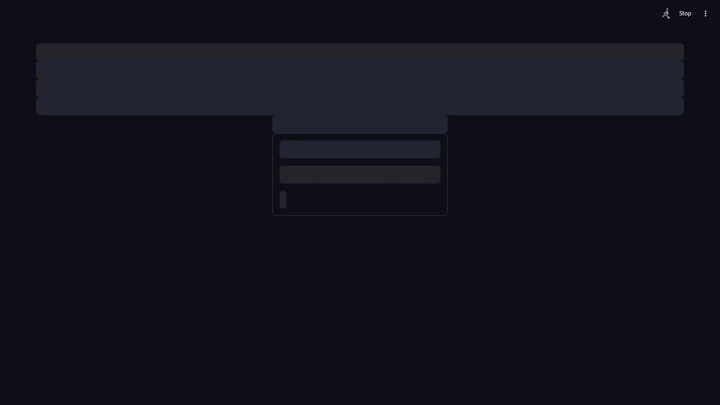

# Painel Financeiro — demonstração com dados fictícios

Painel de acompanhamento financeiro (contas a receber, limite de crédito e faturamento) feito em
**Python + Streamlit + Pandas**. Este repositório é uma **amostra**: roda as telas com **dados 100%
inventados** (nomes de empresas, valores e datas), sem banco de dados e sem nenhuma
informação real.

> Todos os dados são gerados por `dados_ficticios.py` com semente fixa, então a demonstração é
> sempre igual. Nenhuma pessoa, empresa ou valor real aparece aqui.

## Veja em movimento



## O que o painel mostra

| Tela | Para que serve |
|------|----------------|
| **Faturamento Cliente/Grupo** | Decisão de faturamento em uma tela: limite de crédito (total, consumido em NF e pedidos, disponível, % utilizado), situação documental e do faturamento, adiantamentos, inadimplência, aging, distribuição por estado e histórico faturado **por ano** e **dos últimos 12 meses** (variação sobre o mesmo mês do ano anterior). |
| **Situação Cliente** | Visão de um cliente: saldo em aberto (inclusive em moeda estrangeira), aging de vencimento, situação dos títulos e lista de títulos. |
| **Visão Geral MI-ME** | Carteira inteira, com os dois mercados lado a lado (nunca somados), aging por faixas e faixa de indicadores. |
| **Mercado Interno** | Títulos em reais: inadimplência, aging, saldo por banco, recebimentos e ranking de clientes. |
| **Mercado Externo** | Títulos em US$, € e £, com **PTAX** do Banco Central, **valor atualizado e variação cambial** (card total com participação por moeda), impacto cambial por moeda, **país** de cada cliente e painel de **containers em aberto** (por cliente e por país). |
| **Faturamento por Estado** | Mapa do Brasil por UF, colorido pela métrica escolhida (**faturado** em violeta, **em aberto** em verde, **inadimplência** em vermelho e **variação**) e pelo período (o ano atual, com meses fechados, ou qualquer ano fechado desde 2019). Ao clicar em um estado, o card de detalhe passa a mostrar a métrica escolhida primeiro, além do top 8 e dos **maiores clientes** (lista com rolagem); clicar de novo volta ao Brasil. Abaixo do mapa, o card **Total Faturado** (por ano e por mês) segue o estado escolhido. Lista de clientes com o faturamento do ano anterior e do atual, e Excel. |
| **Inconsistências** | Lançamentos com erro, com resumo por categoria, tabela de uma linha por lançamento, Excel e imagem. |
| **Grupo de Crédito** | Limite, consumo e situação por grupo econômico e por cliente do grupo. |

Cada tela exporta **Excel** e gera uma **imagem pronta para e-mail** com os mesmos gráficos e cards.

## Login, menu e tela inicial

- **Login simulado:** a demonstração abre em uma tela de login com o logo **BI-FINANCEIRO**
  (usuário `admin`, senha `admin`, sem autenticação real).
- **Tela inicial:** depois do login aparece "Olá, Administrador!" e nenhuma aba aberta; o painel é escolhido no menu.
- **Menu lateral:** logo, nome do usuário, tempo restante de acesso (contagem regressiva) e o botão **Sair**,
  seguidos do menu **Relatórios** e dos grupos **Financeiro** (Visão Geral MI-ME, Mercado Interno, Mercado Externo
  e Inconsistências) e **Comercial** (Grupo de Crédito, Situação Cliente, Faturamento Cliente/Grupo e Faturamento por Estado).
- **Acessos (botão Admin):** ao lado do **Sair**. Mostra como o painel real controla quem vê o quê: **grupos** com membros
  e painéis/relatórios liberados (um interruptor "Todos" por painel). Quem está em mais de um grupo recebe a soma e
  quem não está em nenhum não acessa nada. Na demonstração os usuários e grupos são fictícios e a busca de usuários usa uma
  lista inventada.
- **Faixa de indicadores (ticker):** em *Contas a Receber > Visão Geral*, uma faixa rolante acima dos cards mostra
  total em aberto, vencido (% de inadimplência), a vencer em 7 dias, prazo médio, PTAX do US$ e do €
  (com variação do dia), maior devedor e quantidade de títulos. Pausa ao passar o mouse e respeita o botão **Ocultar**.
- **Relatórios:** o menu **Relatórios** reúne 8 relatórios (Aprovadores, Contas a Pagar, Boletos DDA,
  Contas a Receber - Exportação, Variação Cambial ME, Desconto Financeiros Pendentes, Boleto Não Gerado e
  Grupo de Crédito), todos com exportação para Excel e dados fictícios gerados em `dados_ficticios_extra.py`.

## Animações

Os gráficos principais entram com uma animação curta (cerca de 1 segundo), feita **só com CSS**
(sem JavaScript, sem varredura da página e sem custo de processamento no servidor):

| Onde | Efeito |
|------|--------|
| Aging de vencimentos (Contas a Receber, Situação Cliente, Faturamento) | barras crescem da esquerda para a direita |
| Rosca "Situação" (Contas a Receber, Situação Cliente, Grupo de Crédito, Faturamento) | a rosca se desenha até o valor |
| Distribuição por banco e por estado, limite de crédito | barras empilhadas e barras de ranking crescem |
| Total Faturado (por ano e últimos 12 meses) | linha e área reveladas da esquerda para a direita |

A animação roda quando o gráfico aparece (abrir a tela, trocar de cliente ou grupo, abrir uma aba) e não se repete
ao clicar em **Atualizar**. Os cards e os números não são animados, e quem usa "reduzir movimento" no sistema
operacional não vê as animações. Os estilos estão em [`assets/styles.css`](assets/styles.css) (classes `an-wipe`,
`an-rosca` e `an-area`).

## Como rodar

```bash
pip install -r requirements.txt
streamlit run app_demo.py --server.port 8590
```

No Windows, dê dois cliques em **`ABRIR DEMO.bat`**. O navegador abre em `http://localhost:8590`; entre com `admin` / `admin`.

## Estrutura

```
app_demo.py          # login, menu lateral e navegação da demonstração
dados_ficticios.py   # gera os dados inventados (clientes, títulos, grupos, faturado)
dados_ficticios_extra.py  # dados fictícios dos relatórios (contas a pagar, aprovações, boletos DDA, inconsistências)
services/            # permissões por grupo (config/permissoes.json) e diretório de usuários fictício
views/               # telas e relatórios
components/          # cards e botões reutilizáveis
assets/              # estilos (inclui as animações em CSS)
utils/               # imagem para e-mail, exportação Excel, formatação, PTAX
query/               # exemplos de consultas SQL (nomes genéricos, schema DOMINIO)
```

## Consultas de exemplo

A pasta [`query/`](query) traz versões **genéricas e ilustrativas** das consultas que alimentam as
telas (schema `DOMINIO`, tabelas e colunas com nomes genéricos, códigos fixos como parâmetros).
Elas explicam a lógica, mas não são as consultas reais.

## Observações

- A cotação PTAX do mercado externo é consultada na API pública do Banco Central (`olinda.bcb.gov.br`);
  sem internet, esse bloco fica vazio e o resto funciona normalmente.
- Tecnologias: Python, Streamlit, Pandas, Plotly e Pillow (imagens para e-mail).
